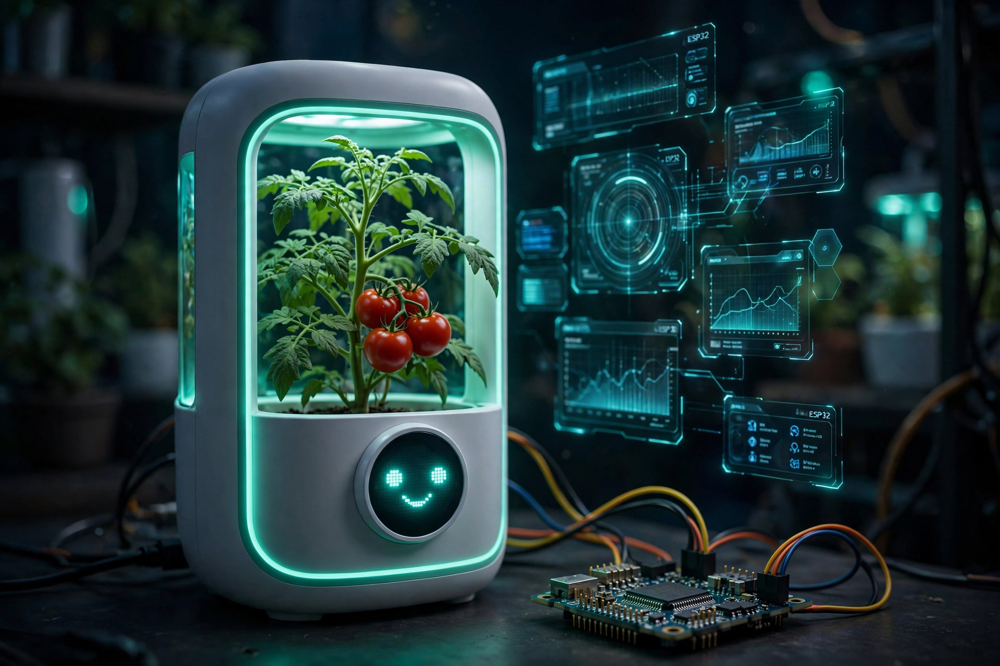
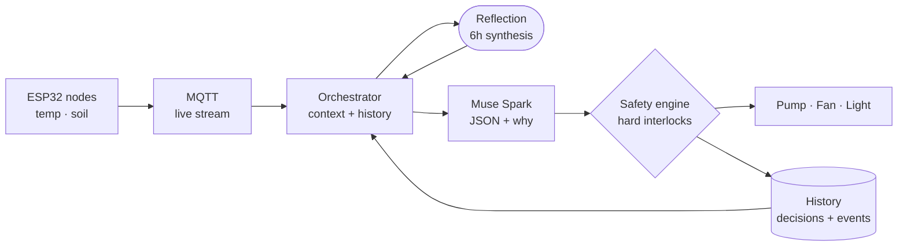
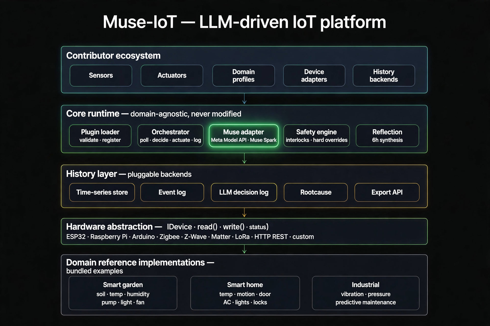
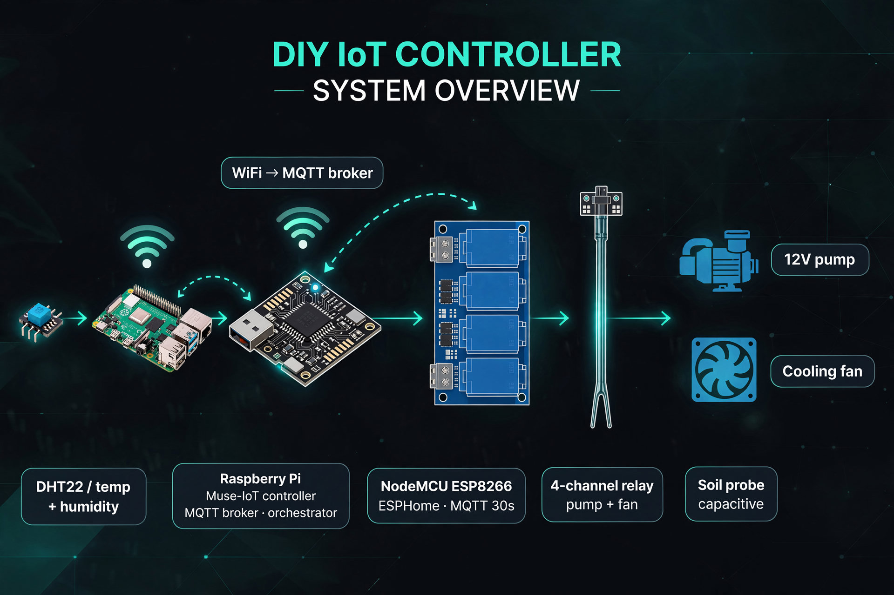
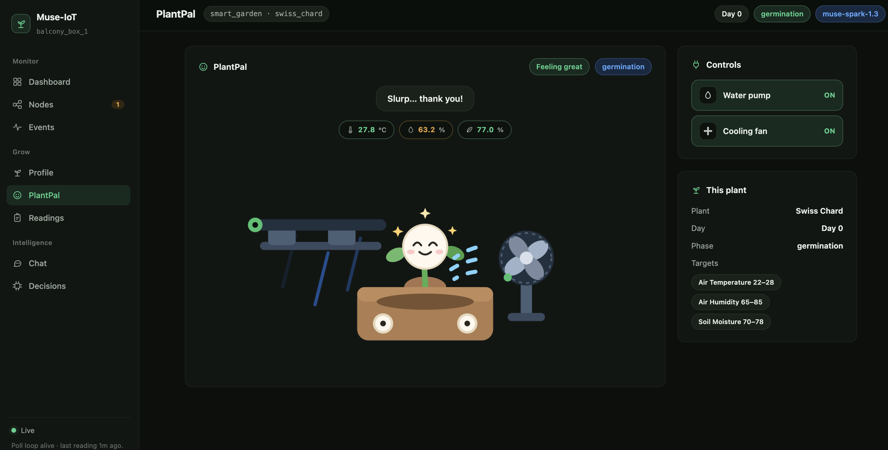
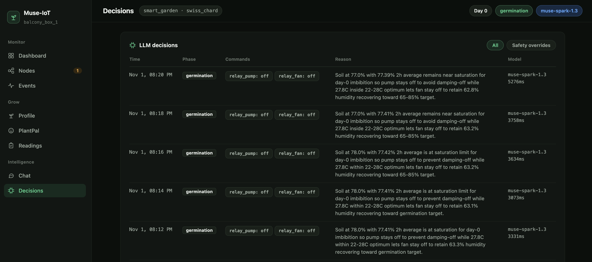
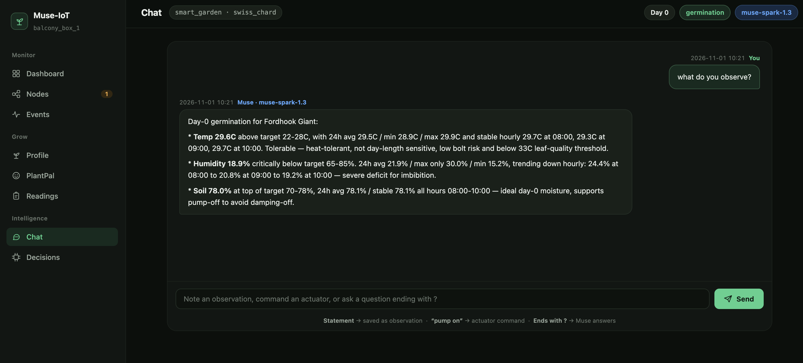
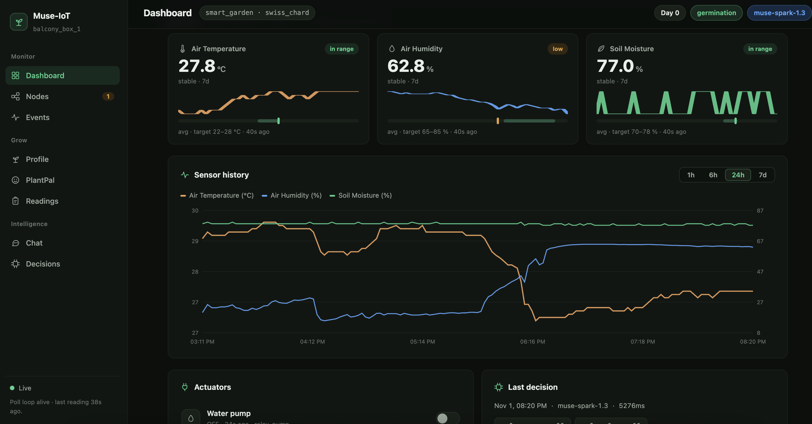

# Muse-IoT

<p align="center">
  
</p>

[](LICENSE)
[](https://dev.meta.ai/models/muse-spark)
[](https://cerebralvalley.ai/e/meta-ai-developer-hackathon/live)

Give every plant a brain. A Meta model that reads your sensors, reasons like a farmer, and waters — every 120 seconds.

Muse-IoT is an LLM-driven IoT platform: sensor nodes stream over MQTT, an orchestrator assembles live readings + history + reflection into one prompt, Muse Spark decides, a safety engine validates, and actuators fire. Traditional IoT is `if temp > 32: pump.on()` — a state machine in a smart costume. This is judgment.

Push the Frontier track, built with Muse Spark (`muse-spark-1.3` through the Meta Model API) for the Meta Global AI Developer Hackathon, 26 Oct to 4 Nov 2026.

- Demo video: [`design/muse-iot-demo-3min.mp4`](design/muse-iot-demo-3min.mp4)

> Live system driving real relays. Use your own hardware at your own risk; the safety engine is a backstop, not a certification.



## Headline facts

- **Real decisions, real relays.** Swiss chard on a 33°C HCMC balcony: temp 30.8 vs 22–28 target, soil 67.9% borderline — Muse held the pump off to avoid damping-off and ran the fan for circulation only.
- **Farmer-level reasoning, logged.** *"Temperature at 30.8°C is beyond what the fan can address — this is external ambient heat, not internal heat load."* Every decision carries a plain-English reason plus model + latency (3–5s).
- **$15 rig.** NodeMCU ESP8266 + 4-channel relay + DHT + capacitive soil probe in a styrofoam cooler, Pi controller over WiFi. Intelligence scales with the model, not the budget.
- **Trustworthy loop.** Safety engine force-cut a fan at 1833s ≥ 1800s limit with a 600s cooldown; every override is logged, expandable, and explainable in chat.

## Who it is for and how it is used

The target user is anyone running sensors and relays — a balcony gardener, a greenhouse operator, a hardware tinkerer — who is tired of hardcoded thresholds that can't see a storm coming or learn their soil.

1. **Wire the rig** — ESP32/ESP8266 nodes over MQTT (ESPHome), relays to pump/fan/light, Pi or PC as controller.
2. **Describe the setup in YAML** — sensors, actuators, plant profile with growth phases and targets; no core code changes.
3. **Start the loop** — `muse-iot start`: Muse reasons every 120s, reflects every 6h, and you watch PlantPal's face or ask chat *why*.

## How Muse is used

Muse Spark (`muse-spark-1.3`, Meta Model API, JSON mode) is the only LLM — the adapter rejects any other provider. No fallback models, no mixed runs.

| Role | What Muse does | Why it matters |
|---|---|---|
| A. Decide | Reads sensor snapshot + 48h history + reflection + session state, returns one JSON command per actuator with a `reason` | One brain replaces N threshold rules; reasoning is flie-safe and JSON-validated before anything moves |
| B. Reflect | Every 6h, synthesizes 48h of readings/decisions/overrides into durable insights (*"peaks 18:00–20:00, environmental not equipment failure"*) | The nightly loop learns patterns a threshold can never see; injected into every decision prompt |
| C. Chat | Answers questions (*"what do you observe?"*, *"why water at noon?"*) from live state + history, commands actuators, saves observations | Every action is interrogable; the Telegram-era shade-cloth advice (Binh Dien market, 50k VND/m²) was this role |
| D. Diagnose | `muse-iot analyze` post-mortems a session: rootcause over decisions, overrides, and sensor trends | Failures become explained incidents, not mystery graphs |

> **Unexpected capability.** Asked about a 30.8°C plateau after 35+ fan cycles, Muse distinguished *external ambient heat* from *internal heat load* on its own — then declined to fight physics. That sentence is why thresholds lost.

## How it works



- The orchestrator polls on a fixed cadence (LLM call every 120s) and assembles a cache-stable system prompt (domain rules, JSON schema, latest reflection) plus a fresh user block (sensors, targets, phase/day, session deltas, recent overrides).
- The LLM adapter enforces Muse-only, validates JSON strictly, and escalates token budget on length cutoffs instead of silently truncating reasoning.
- The safety engine applies hard interlocks (duration limits, cooldowns, target guards) the model cannot override; overrides become first-class events.
- History (time-series + event log + decision log) feeds reflection, rootcause, chat, and the offline web UI.

## Architecture

Five layers; the core never changes per domain. New hardware is a plugin, new use cases are YAML.



| Plugin | What it does | Min required |
|---|---|---|
| **Sensor** | Maps a hardware sensor to an MQTT topic | `sensor.yaml` |
| **Actuator** | Maps a relay/PWM output with safety interlocks | `actuator.yaml` |
| **Device adapter** | Implements `read()` / `write()` / `status()` for a hardware platform | `device.yaml` + `adapter.py` |
| **Domain** | Sensors, actuators, safety rules, and LLM prompt for one IoT use case | `domain.yaml` + `prompt.md` |
| **History backend** | Storage for sensor time series and events | `backend.yaml` + `backend.py` |

See [CONTRIBUTING.md](CONTRIBUTING.md) for how to write each type, and [docs/architecture.md](docs/architecture.md) for full design.

## Hardware

Pi controller ⇆ ESP node over WiFi → relay → pump + fan. Total: under $15 plus the cooler.



| Device | Transport | Status |
|---|---|---|
| ESP32 / ESP8266 (ESPHome or Arduino) | MQTT | ✅ included |
| Multiple ESP boards (multi-node) | MQTT | ✅ included |
| Raspberry Pi (controller) | WiFi + GPIO | ✅ included |
| Arduino | Serial / USB | 🚧 planned |
| Zigbee (via coordinator) | Zigbee2MQTT | 🚧 planned |

## Features

**PlantPal** — the plant has a face and moods: thirsty, hot, cold, happy, growing from sprout to fruit. Controls fire real actuators; the bubble speaks ("Slurp… thank you!").



**Decisions log** — every 2-minute call preserved: phase, commands, plain-English reason, model, latency. Safety overrides filterable.



**Chat** — ask *"what do you observe?"* and Muse answers with 24h avg/min/max per sensor. Statements become observations; `"pump on"` commands actuators.



**Dashboard + Nodes** — fleet summary with 24h charts and last decision; per-node detail with sensor matrix and online state. Fully offline UI (no CDN), live over SSE.



## Quick start (Swiss chard garden box)

```bash
git clone https://github.com/muse-iot/muse-iot
cd muse-iot
pip install -e ".[dev]"

# Edit config — set META_API_KEY, plant and device as needed
cp config.example.yaml config.yaml
nano config.yaml

# Validate everything loads
muse-iot validate

# Start
muse-iot start
```

Get a Muse key at https://dev.meta.ai and set `META_API_KEY` or `llm.api_key`:

```yaml
llm:
  provider: muse
  model: muse-spark-1.3
  api_key: YOUR_META_API_KEY
```

## CLI

```bash
muse-iot start                        # Start poll loop
muse-iot ui                           # Web UI (http://localhost:7070)
muse-iot status                       # Last LLM decision + sensor state
muse-iot history --hours 24           # Sensor history table
muse-iot observe "Leaves yellowing"   # Add observation (fed to LLM)
muse-iot analyze <session_id>         # Rootcause analysis (LLM post-mortem)
muse-iot plugins                      # List all loaded plugins
muse-iot validate                     # Check config + plugins
```

## Reference implementations

| Domain | Profile | Hardware | Status |
|---|---|---|---|
| Smart garden | Swiss chard, bok choy, Thai basil | ESP32 + MQTT | ✅ included |
| Smart home | - | ESP32 / Zigbee | ✅ included |
| Aquarium | - | ESP32 + MQTT | 🚧 planned |

## License

MIT
